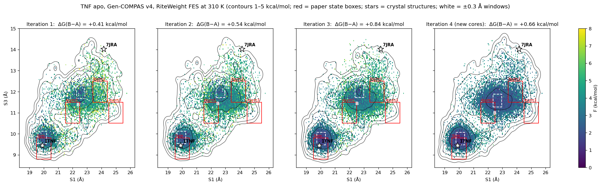

# Example: TNF-α symmetric ↔ asymmetric trimer (apo)

**System.** Apo TNF-α trimer (chains A/B/C, residues 6–157; 7134 protein atoms; ~76k atoms
solvated), ff14SB / TIP3P / 150 mM KCl, 310 K, 4 fs with HMR. End states: A = 1TNF
(symmetric), B = 7JRA with the ligand removed (asymmetric). Both were equilibrated with a
staged, restrained ~9 ns protocol, then run unbiased for 5 ns (initial Gen-COMPAS data).

**CVs used for analysis** (the VCN learns its own committor; these are only for
projecting and labelling), on the distorted chain C → chain A interface:

| CV | 1TNF | 7JRA |
|---|---|---|
| S1 | 19.90 Å | 24.16 Å |
| S2 | 8.61 Å | 12.00 Å |
| S3 | 9.43 Å | 14.01 Å |

**Protocol (v4).** 20 targets/iteration × (TMD from A + TMD from B, 500 ps) → 2 ns unbiased
each; diffusion noise schedule 10/10/5/3/3, epochs 300/20/10/10/10; RiteWeight with 100
clusters and a 500 ps lag. Committor cores were moved to the FES minima after iteration 3:
A (20.0, 9.8) ± (0.5, 0.4) Å and B (22.7, 12.0) ± (0.5, 0.4) Å in (S1, S3).

## Results

ΔG(B − A) in kcal/mol, 310 K, ± = bootstrap over trajectories (200 resamples):

| Definition | Iter 1 | Iter 2 | Iter 3 | Iter 4 |
|---|---|---|---|---|
| ±0.1 Å window at minima | +0.41 ± 0.69 | +0.40 ± 0.53 | +0.61 ± 0.59 | **+0.71 ± 0.30** |
| ±0.2 Å window at minima | +0.43 ± 0.57 | +0.53 ± 0.46 | +0.92 ± 0.40 | **+0.72 ± 0.24** |
| ±0.3 Å window at minima | +0.41 ± 0.55 | +0.54 ± 0.45 | +0.84 ± 0.38 | **+0.66 ± 0.23** |
| Whole basin | +0.36 ± 0.45 | +0.21 ± 0.35 | +0.55 ± 0.25 | −0.10 ± 0.19 |
| Paper state box Asym1 (padded 0.3 Å) | +1.49 | +1.14 | +1.50 | +0.62 ± 0.29 |
| Paper state box Asym2 | +2.60 | +1.99 | +2.43 | +1.35 ± 0.31 |
| Paper state box Asym3 | +4.25 | +4.01 | +4.18 | +3.08 ± 0.37 |
| Effective sample size (frames) | 158 | 281 | 705 | 2183 |

Iteration 5 (the last one) results will be added here.

**Interpretation.**

- The **symmetric basin is deeper and narrow.** The asymmetric basin is broad and shallow
  (an entropically large family of partly opened structures). Depth difference
  ≈ +0.7 ± 0.25 kcal/mol, while whole-basin populations are about equal.
- **The apo B minimum is only partly asymmetric.** Its CA RMSD is 2.40 Å to 1TNF and 2.25 Å
  to 7JRA. 7JRA-like structures (down to 1.38 Å) are sampled but rare, about 3 kcal/mol up
  in iteration 3. This is consistent with an inhibitor capturing a minor, already
  accessible conformation.
- **Mechanism along the minimum free-energy path:** S3 (the C–A interface) opens first,
  then S1. Chain C tilts ~9° as a rigid body, and its 102–109 loop (incl. Arg103) moves 5–8 Å.
- **Caveats.** No single 2 ns trajectory makes the full transition (4 of 200 go from the A
  region to the B region in CV space); the connection comes from overlapping short
  trajectories (166/200 pass through the S3 10–11 Å bridge). The paper-box values moved
  ~1 kcal/mol between iterations 3 and 4, so the landscape was still changing.
- The bioRxiv meta-eABF study (10.1101/2025.11.28.690881) reports ~5/6/7.5 kcal/mol for
  Asym1/2/3, with a ±2.5–3.3 kcal/mol spread between its two replicates. Our numbers are lower.
  Different method, force-field details and sampling; neither result is a reference value.

## Files

- `results/`: FES figures, and the A→B path movie (40 real MD frames stitched along the
  minimum free-energy path, 1TNF and 7JRA drawn as ghosts; not a single trajectory)
- `structures/`: 1TNF, 7JRA (remapped chains C→A, B→B, A→C and renumbered to
  ECD), real simulation snapshots at the A and B minima and closest to each crystal, the
  40-frame path, and PyMOL scripts (`compare_AB.pml`, `movie_path.pml`)
- `topology/protein_noh.psf/.pdb`: heavy-atom topology used for diffusion training
